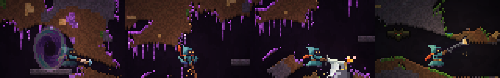

# Veleho



2D-roguelite-prototyyppi Godot 4.7:lle. Huppupäinen velho seikkailee proseduraalisesti
luoduissa luolastoissa ja ulottuvuuksissa. Koko maailma simuloidaan pikseli pikseliltä:
hiekka valuu, vesi virtaa, öljy palaa, happo syövyttää ja räjähdykset repivät maastoa.

## Pelaa

- **Selaimessa:** <https://savo-consortium-of-education.github.io/Veleho/>. Toimii tietokoneella
  näppäimistöllä ja hiirellä (Chrome, Edge, Firefox).
- **Windows:** lataa `veleho-windows.zip` [uusimmasta julkaisusta](../../releases/latest),
  pura se ja käynnistä `Veleho.exe`. Jos Windows varoittaa tuntemattomasta julkaisijasta,
  valitse *Lisätietoja* → *Suorita silti*.

Selainversio tallentaa juoksun selaimen omaan tallennustilaan. Jos haluat jatkaa kesken
kentän, valitse ennen välilehden sulkemista Esc → *Tallenna ja lopeta*.

Pelisuunnitelma: [docs/SUUNNITELMA.md](docs/SUUNNITELMA.md)

## Käynnistys editorissa

1. Avaa kansio Godot 4.7:n projektinhallinnassa (renderöijä: GL Compatibility).
2. Varmista, että pääkohtaus on `res://scenes/main.tscn`
   (Project → Project Settings → Application → Run → Main Scene, tai FileSystem-paneelissa
   hiiren oikea `scenes/main.tscn` → *Set as Main Scene*).
3. Paina F5.

Komentoriviltä projektikansiossa:

```
Godot_v4.7.2-stable_win64.exe --path . --scene res://scenes/main.tscn
```

## Ohjaus

| Toiminto | Näppäin |
|---|---|
| Liiku | A / D |
| Hyppy, pidä pohjassa ilmassa = leijunta | W tai välilyönti |
| Tähtää | hiiri |
| Käytä asetta | hiiren vasen (sauva: ammu, keppi: lataa ja vapauta, miekka: lyö, pullo: kaada) |
| Heitä pullo | hiiren oikea |
| Juo pullosta | F |
| Reppu: loitsujen ja aseiden järjestely | Tab tai I |
| Vaihda asetta | 1–4 tai hiiren rulla |
| Poimi ase tai pullo (täydellä repulla vaihtaa nykyiseen) | E |
| Tauko, asetukset, tallenna ja lopeta | Esc |
| Kehittäjätiedot (FPS, aktiiviset lohkot, materiaali kursorin alla) | F3 |

Näppäimet voi määrittää uudelleen: Asetukset → Näppäimet.

## Mitä prototyypissä on

- **Pikselimaailma:** yli 30 materiaalia (kiinteät, jauheet, nesteet, kaasut, tuli). Mukana
  reaktiot: palaminen, höyrystyminen, jäätyminen, sulaminen, syöpyminen, ruutiräjähdykset
  ja laava + vesi → obsidiaani. Simulaatio päivittää vain muuttuneet alueet (32×32-lohkot,
  joissa on likainen suorakulmio).
- **6 ulottuvuutta:** Hämyluolat, Sienisyvänne, Routaulottuvuus, Ahjoulottuvuus,
  Kristalliulottuvuus ja Tyhjyys (matala painovoima, leijuvat saaret). Jokaisella omat
  materiaalit, nesteet, rakenteet, viholliset, valaistus ja musiikki.
- **Proseduraaliset kentät:** kohinaluolat, taattu reitti alusta porttiin, huoneet,
  materiaalitaskut, pinnoitteet (sammal, lumi, sienet, jääpuikot), nestealtaat, puutasot,
  tiiliraunioit, ruutilaatikot, jättisienet ja kristallipiikit.
- **Aseet:** taikasauvat ja taikakepit, joissa on loitsupaikkoja, miekat (kaarilyönti, joka
  torjuu ammuksia ja leikkaa pehmeää maastoa; elementtimiekat) sekä juomapullot.
  Tilastot, nimet ja **ulkonäkö** generoidaan siemenestä.
- **Loitsujen sijoittelu:** Repussa (Tab) loitsuja raahataan vapaasti sauvojen, keppien ja
  16-paikkaisen loitsupussin välillä. Sauva loitsii paikat järjestyksessä.
  - **12 loitsua:** Kipinä, Tulipallo, Pomppuhelmi, Jääpiikki, Happolima, Pommi,
    Taikaohjus, Meteori, Poraterä, Vesipallo, Järistys ja Salama.
  - **10 muokkainta,** jotka vaikuttavat seuraavaan loitsuun: Tehostus, Kiihdytys,
    Hakeutuvuus, Kimmoisuus, Kaksoisloitsu, Kolmoisloitsu, Räjähtävä, Lävistävä, Tarkkuus ja
    Jättiläinen.
  - **Loitsukääröjä** löytyy kentistä, ja varjomaagit pudottavat niitä.
- **Juomapullot:** pullo täyttyy, kun sen suun upottaa nesteeseen. Vasen kaataa, oikea heittää
  (pullo särkyy ja vapauttaa sisältönsä) ja F juo. Juoman vaikutus riippuu nesteestä:
  Elonneste parantaa, Eetteri palauttaa manan ja leijunnan, vesi sammuttaa, happo ja laava
  satuttavat, myrkkyliete myrkyttää ja öljy tekee helposti syttyväksi.
- **5 vihollista + pomo:** Lima, Siipiö, Varjomaagi, Tulihenki ja Kivikolossi. Joka kolmannella
  tasolla Portinvartija vartioi sinetöityä porttia omalla areenallaan. Sillä on sirpaleryöppy,
  apurien kutsu, maastoa repivä syöksy, raivovaihe ja elementtisade.
- **Eteneminen:** ulottuvuusportti kentän lopussa, ja jokaisen portin kohdalla valitaan
  yksi kolmesta siunauksesta. Lisäksi elämän- ja manakristallit sekä kulta.
- **Asetukset:** kokonais-, musiikki- ja äänitehostevoimakkuus (omat äänikanavat), koko näyttö,
  ikkunan koko, VSync, ruudun tärinä, vahinkonumerot, FPS-näyttö ja näppäinten
  uudelleenmääritys. Tallentuvat tiedostoon `user://settings.cfg`.
- **Hardcore ja tallennus:** juoksu tallentuu jokaisen kentän alussa. *Tallenna ja lopeta*
  (työpöytäversiossa myös ikkunan sulkeminen) tallentaa koko pikselimaailman, viholliset, esineet ja pomon tilan
  juuri siihen kohtaan. Tallennus käytetään kerran, joten sitä ei voi ladata uudelleen
  kuoleman välttämiseksi. Kuolema poistaa kaikki tallennukset, ja seuraava juoksu luodaan
  uudesta siemenestä.

## Rakenne

```
scenes/main.tscn          pääkohtaus (valikko ↔ peli ↔ kuolinruutu)
scripts/autoload/         GameState (juoksu, tallennus), Assets (spritet, fontti, teema), Audio
scripts/core/             game_settings.gd (asetukset, äänikanavat, näppäimet)
scripts/world/            materials.gd, pixel_world.gd (simulaatio), world_gen.gd, dimensions.gd
scripts/entities/         actor.gd (pikselifysiikka), player.gd, enemy.gd + enemies/ (myös boss.gd),
                          projectile.gd, pickup.gd, portal.gd
scripts/combat/           spells.gd, weapon.gd, weapon_gen.gd, weapon_art.gd, perks.gd
scripts/game/game.gd      kentän elinkaari, kamera, valot, räjähdykset, miekkaiskut
scripts/ui/               hud.gd, inventory_menu.gd (reppu), settings_menu.gd, main_menu.gd,
                          perk_choice.gd, pause_menu.gd, death_screen.gd
shaders/                  world.gdshader (materiaalien väritys), light.gdshader (pimeys ja valot)
assets/                   spritet, pikselifontti, äänet ja musiikki (generoitu)
tools/                    assettigeneraattorit (Python + Pillow/numpy)
tests/                    kehitystyökalut: kenttäesikatselu, fonttitesti, automaattinen pelitesti
export_presets.cfg        vientiasetukset: Web (selain) ja Windows
.github/workflows/        GitHub Actions: rakentaa pelin ja julkaisee selainversion GitHub Pagesiin
```

## Assettien uudelleengenerointi

Kaikki grafiikka ja äänet on tehty skripteillä, joten niitä voi muokata ja ajaa uudelleen:

```
python tools/art/gen_characters.py     # pelaaja ja viholliset
python tools/art/gen_fx_ui.py          # ammukset, efektit, esineet, UI, logo, fontti
python tools/audio/gen_audio.py        # äänitehosteet ja musiikki
```

PNG-tiedostoja voi myös muokata suoraan esimerkiksi Asepritessä.

## Kehitystestit

```
# Kenttä kokonaisena kuvana (ulottuvuus, siemen, tiedosto)
Godot --path . --scene res://tests/worldgen_test.tscn -- caves 1234 C:/temp/kentta.png

# Automaattinen pelitesti: simuloi syötteitä, tulostaa ajat ja tallentaa kuvakaappauksia
Godot --path . --scene res://scenes/main.tscn -- --autotest --shots C:/temp --dim forge --seconds 10
#   --scenario basic | portal | death | combat | spells | items | boss | save | resume
#   (pomo: --scenario boss --level 3; tallennus: aja ensin save, sitten resume)
```

Tallennukset ovat Godotin `user://`-kansiossa
(`%APPDATA%\Godot\app_userdata\Veleho\`): `veleho_run.save` (kentän alku),
`veleho_world.save` (kesken kentän), `veleho_meta.save` (tilastot) ja `settings.cfg`.
Selainversiossa sama `user://` on selaimen tallennustilassa (IndexedDB).

## Vienti omalla koneella

Vientiasetukset ovat tiedostossa `export_presets.cfg` (Project → Export): **Web** ja
**Windows**. Vientiin tarvitaan Godot 4.7.2:n vientipohjat (Editor → Manage Export Templates).
Testikansio `tests/` jätetään pois paketista.

```
Godot_v4.7.2-stable_win64_console.exe --headless --path . --export-release "Web" build/web/index.html
Godot_v4.7.2-stable_win64_console.exe --headless --path . --export-release "Windows" build/windows/Veleho.exe

# Selainversion kokeilu: http://localhost:8060
python -m http.server 8060 --directory build/web
```

`build/` ei mene gittiin. Sen `.gdignore` estää Godotia tuomasta vientitiedostoja
(esim. `index.png`) takaisin projektiin.

Selainversio käännetään ilman säikeitä (`variant/thread_support=false`). Siksi se toimii
GitHub Pagesissa ja itch.io:ssa ilman erityisiä HTTP-otsakkeita. Pelin Lopeta-napit on
piilotettu selaimessa, koska selainvälilehti suljetaan itse.

## Julkaiseminen GitHubiin

Työnkulku [.github/workflows/build.yml](.github/workflows/build.yml) rakentaa selain- ja
Windows-version jokaisesta `main`-haaran pushista ja julkaisee selainversion GitHub Pagesiin:
<https://savo-consortium-of-education.github.io/Veleho/>.

1. Pages otetaan käyttöön kerran: repon **Settings → Pages → Build and deployment →
   Source: GitHub Actions**.
2. Jos ajo ehti epäonnistua ennen Pagesin käyttöönottoa, avaa **Actions → Rakenna ja julkaise**
   ja valitse *Re-run failed jobs*.
3. Ladattava versio: luo tagi, niin työnkulku tekee GitHub-julkaisun (Releases) ja liittää
   siihen `veleho-windows.zip`- ja `veleho-web.zip`-tiedostot:
   ```
   git tag v0.1.0
   git push origin v0.1.0
   ```

Saman voi tehdä omaan repoon: luo GitHubissa julkinen repo, lisää se `origin`-remoteksi,
pushaa `main` ja ota Pages käyttöön kuten yllä.

`veleho-web.zip` kelpaa sellaisenaan myös itch.io:hon (Kind of project: HTML).
